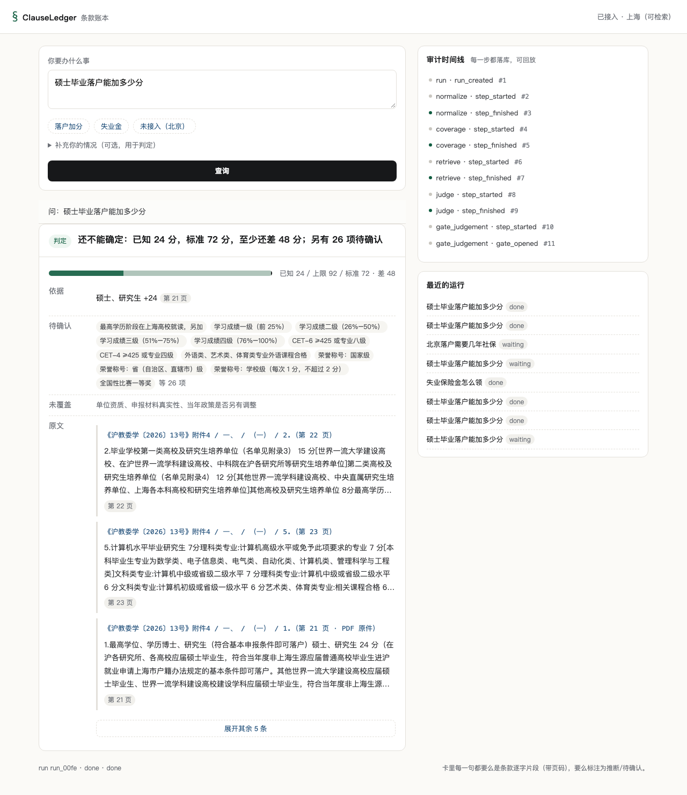

# ClauseLedger · 条款账本

> 输入你的情况，输出**你能办哪条政策、凭什么、还差什么**。
> 每条结论都能点回官方原文的某一句；判不了就明说缺什么，而不是编一个答案。

**一句话架构**：规则下结论，检索负责找条款，LLM 只负责解释。
**名字取自账本**：只追加不覆盖、可对账、可回放。

`Python 3.13` · `FastAPI` · 混合召回（BM25 + bge-small-zh）· 状态与事件落 SQLite（`data/runtime.db`，WAL）· 每步一个 OTel span（`data/runs/traces.jsonl`）

> **实际用了什么，写什么**：LangGraph、Postgres/pgvector、MCP、OTel 目前只在设计里
> （`docs/ARCHITECTURE.md` / `docs/FOUNDATION.md`），代码还没接。等接了再写进这一行。

---

## 首屏四个数（dev 实测，2026-11-20）

口径统一写在 `docs/EVAL-SPEC.md`：官方 dev **n=105**（排除 7 条指代题、2 条金标失效），
问法补全主语，金标按文号，重排关闭。

| 指标 | 数值 | 口径 |
|---|---|---|
| 金标文件进前 10 名（R@10） | **86%** | L1 召回，分母 105 |
| 金标文件排第 1（P@1\|R@10） | **79%** | L2 排序，分母=金标已在池内的 90 题 |
| 作答精度（开口时对的比例） | **71%** | L5 决策，95 次作答 / 71 次引对 |
| 引用**可定位** / 引用**能支撑** | **100% / 约 20%** | 30 题人工标（单标注者，初标） |
| 上下文含官方答案句 | **71.4%** | L3 装配，分母 70（答案能在语料里找到的题） |
| 生成答案覆盖官方数字事实 | **42.1%**（16/38） | L4 生成，分母 38 个可核对事实 |

> L1–L5 来自 `tools/eval_layers.py`，装配来自 `tools/eval_context.py`，生成来自 `tools/eval_generate.py`，
> 引用来自 `tools/eval_citation.py`。
> 全部只跑 dev；test/holdout 冻结在 `eval/FROZEN-v3.json`，改动一次只跑一次。
> **能支撑 20% 比可定位 100% 更值得写在这**——它说明"引文没编"和"引文有用"是两件事。

---

## 崩一次给你看

```bash
bash ops/demo_recovery.sh          # 约 40 秒，两个中断点
```

- A：停在"等人批准"时 `kill -9`，重启后原 run 继续，`applied=3 reused=0`，再批一次 409；
- B：待办**已经写进库**、`step_finished` 还没落盘时硬退出，恢复后 `applied=0 reused=3` ——
  重跑了一遍，一条没多。

语义写在 `docs/RECOVERY.md`：at-least-once 重入 × 按条幂等 = **可观察的恰好一次**；
物理恰好一次不承诺（外部系统要靠对方的幂等键）。原始输出在 `docs/RECOVERY-DEMO.md`。

---

## 看一眼



```bash
python -m uvicorn app.api.server:app --port 8010   # http://127.0.0.1:8010/
```

单页做三件事：提问 → 看卡（判定/标准/拒答）→ 审批（含**将被写入的条目**）。
每一步都落 `events` 表，右侧时间线可回放。

卡片下方那段「模型解读」是生成层，**只解释证据、不改变判定**：每句必须带 `[E#]`，
句中的数字必须能在被引证据里找到，否则**逐句丢弃**（截图里 6 句全带引用）。
拒答卡不生成——没有证据时让模型说话，它一定会编。细节见 `docs/UI.md`。

---

## 五个试过但没用的方案

这些都在仓库里留了代码和数字，不是"没做"，是"做了、没赢、关掉了"：

| 方案 | 结果 | 为什么没用 |
|---|---|---|
| 稠密召回（bge-small-zh） | hit@1 55.4%→56.5%，p=1.000 | 与 BM25 的候选池几乎重合，救不回难题 |
| RRF 混合 | 60.9%，p=0.267 | 两路都只把候选从第 11 名挪到第 4 名，进不了前 3 |
| cross-encoder 重排 | 弱基线 +6~8pp；我们自己的融合池上 **51.0%→40.6%**（6 好 16 坏） | 重排修的是弱基线的排序噪声，融合已经吃掉一部分；再叠一层会把文号错的条款顶上来 |
| 结构前缀 / LLM 上下文（复刻 Anthropic Contextual Retrieval） | 63%→57~59% | 我们条款才 34 token，加 50–100 token 上下文占 40%，长度归一化直接扣分 |
| 文档级分数聚合（DHR 式） | 56%→46%（α 越大越差） | 长文件的多条平庸条款累加，挤掉真正对口的小文件 |

结论写在 `docs/RECALL-COMPARE.md`、`docs/RANK-PROBES.md`：**瓶颈不在"换哪种召回器"，在排序与决策**。

---

## 为什么不是又一个 RAG Demo

同样的需求，常规做法与本项目的分歧点只有五处。每处都是**用成本换性质**，不是白拿：

| 位置 | 常规做法 | 本项目 | 换到了什么 | 付出了什么 |
|---|---|---|---|---|
| **判定** | LLM 读检索结果直接下结论 | 规则 DSL 判定，LLM 只解释 | 结论可测、可复现、可归因 | 规则抽取会错，误差被推到解析层 |
| **状态** | 只存 checkpoint | checkpoint 是恢复源，`run_events` 是审计真源 | 崩溃可恢复 + 事后可举证 | 两份状态要一条对账查询兜底 |
| **审批** | 一个 `approved` 布尔 | 状态机：`param_hash + nonce + TTL + consumed_at` | "批了没执行"与"执行了没批"都查得出 | 门控 UI 半天，对账逻辑一天 |
| **观测** | 一套 trace 全量存 | 审计/调试两条管线，正文外置只留 ref | 审计不可变，平台可随时清空 | 两套配置 + 存储与访问控制 |
| **副作用** | 失败重试 | outbox + `Idempotency-Key` | 可观察的恰好一次 | 依赖被调方实现幂等 |

每一条的依据都不是"经验上如此"，而是外部规范或源码——`docs/FOUNDATION.md` 里逐条给了出处。

其中一条我特意保留在文档里没绕开：**外部调用已返回、结果未落库时崩溃，重跑会再调一次**。对 LLM 是成本，对写操作只能靠被调方幂等兜住。这是这套设计里唯一消不掉的窗口，写进崩溃表第 3 行了。

---

## 一个真实的起点（实测，非设想）

上海市教委 2026 年应届生落户通知：

- 正文 **17 KB / 38 行 / 0 张表格**，全文不出现「72」
- 真正的评分办法在**附件**里，附件在**另一个域名**
- 搜索"上海应届生 72 分"，前 8 条全是**中介计算器**

政策不是不存在，是**散落、改版、且规则主体藏在附件里**。用户读到的公告是壳。

所以这个项目不卖"算得准"（已商品化），卖三件事：**可核对、敢不知道、可复现**。

---

## 一次请求经过什么

```
采集 → 条款化 → 规则结构化 → 画像 ─┐
                                    ├→ 判定 → 冲突检测 ─┐
                                    │   (四态)          ├→ 组装 → 核验 ─┐
                                    │                   │  (挂不上就删)  ├→ 门控 → 动作
                                    └───────────────────┴────────────────┘   ⇢ interrupt
                                                                             审计 → 评测
```

三个中断点全部落库：`clarify`（缺字段）、`gate_judgement`（判定要人确认）、`gate_action`（要写待办）。杀进程重启后从最近的 checkpoint 继续——**被中断的那个节点会整体重跑**，所以节点内所有副作用都幂等。

四态判定：`satisfied` / `unsatisfied` / `unknown` / `not_applicable`。
"不符合"和"不适用"必须分开——把两者混成一个 `no`，是最容易在面试里被问穿的地方。

---

## 状态

| 阶段 | 内容 | 状态 |
|---|---|---|
| S1 采集 | 574 份正文 / 337 城登记、327 可达 / 6 孤儿 / 5 份 PDF 数字被丢已修 | **可用** |
| S2 解析 | 5 种载体（HTML / PDF 文本层 / 扫描 OCR / DOCX / DOC），`v0.3.18` | **可用** |
| S3 抽取 | 文号 100%、成文 78%、印发 99%、发文机关 100%、废止关系 143 条 | **可用** |
| S4 结构化 | 5,983 条入索引条款 / 6,064 子块 / 编号七级 + `part`（正文 vs 附件） | **可用** |
| S5 检索 | 混合召回 + 三态弃权（answer / no_direct_clause / refusal） | **可用** |
| S6 判定 | 只有落户（37 项 / 248 分 / 四态 + 区间） | **单事项** |
| S7 评测 | 227 题三档 + 口语 64 + 无政策 12 + 域外 30；分层与漏斗 | **可用** |
| S8 编排 | 十一步状态机 / 两处 `interrupt` / 按条幂等 / 三张卡 / CLI + 四端点 | **无界面** |

**现在打开仓库，代码已经能跑一条完整链路**：`python -m tools.run "硕士毕业落户能加多少分" --profile your.json`
——会停在 `gate_action` 等你批，批准后写 3 条待办，再跑一次 `applied=0, reused=3`。

还没有的：网页界面、第二个判定器、人工复核过的引用样本。

---

## 面试官导航（5 分钟）

1. [`docs/ARCHITECTURE.md`](docs/ARCHITECTURE.md) — 系统长什么样，八个环节各自的契约与验收
2. [`docs/FOUNDATION.md`](docs/FOUNDATION.md) — 底座凭什么可信：执行 / 状态 / 副作用 / 门控 / 观测 / 版本，每节带出处
3. [`docs/EVAL.md`](docs/EVAL.md) — 怎么证明它行：用例格式、指标门槛、消融、反刷分
4. [`docs/FUNNEL.md`](docs/FUNNEL.md) — 端到端漏斗：每一步掉多少、掉在哪
5. [`docs/RECALL-COMPARE.md`](docs/RECALL-COMPARE.md) — 四种召回器的对照与"一个都没上线"
6. [`docs/ABSTENTION.md`](docs/ABSTENTION.md) — 什么时候闭嘴，以及为什么阈值是 5.3 / 1.25
7. [`docs/research/`](docs/research/) — 立项时的实测：岗位面经、开源盘点、六场景 curl 结果

想直接看"这人怎么想问题"的，读 [`docs/AUDIT.md`](docs/AUDIT.md)：五轮自审，包括我自己推翻的三条结论。

---

## 不做什么

- 不做实时政策订阅推送
- 不做多轮自由对话（对话只用于澄清字段）
- 不做全国覆盖（超范围明确拒答，并给覆盖声明）
- 不做"回答质量打分"（只评事实与行为，不评文采）

---

## 目录

```
docs/            设计与研究
adr/             架构决策记录（一个决策一页）
data/fixtures/   小体量测试语料（入库）
data/raw/        抓取的原文副本（不入库，可再生）
tests/           单元与集成测试
```

## 待定（写在这里，避免含糊）

- [ ] 首批城市清单与各自能力级别（L1 仅检索 / L2 可判定 / L3 可动作）
- [ ] 许可证
