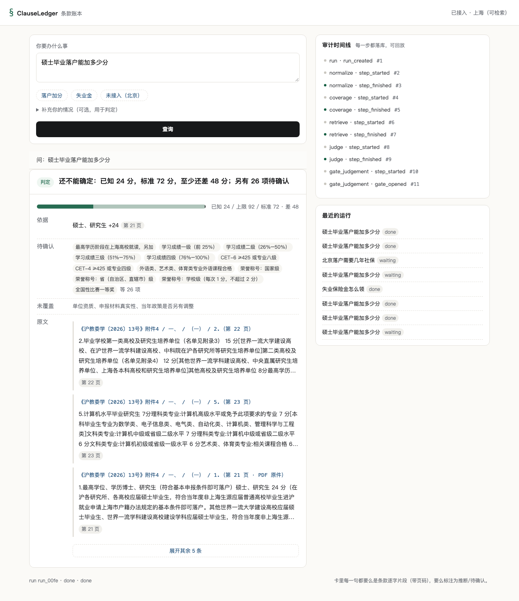
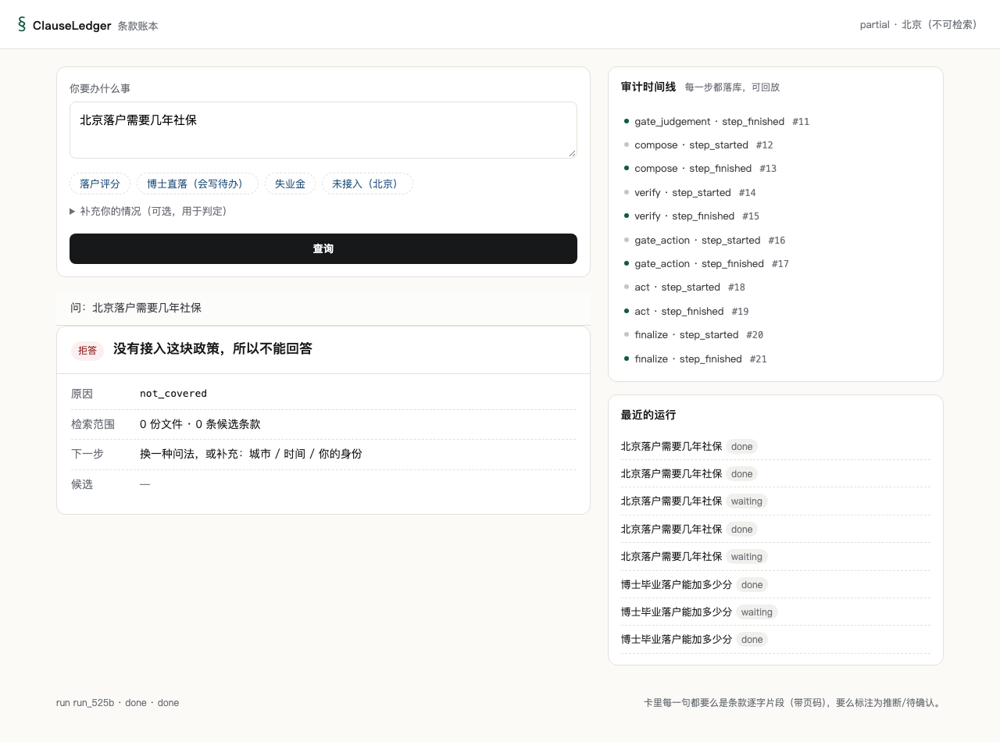
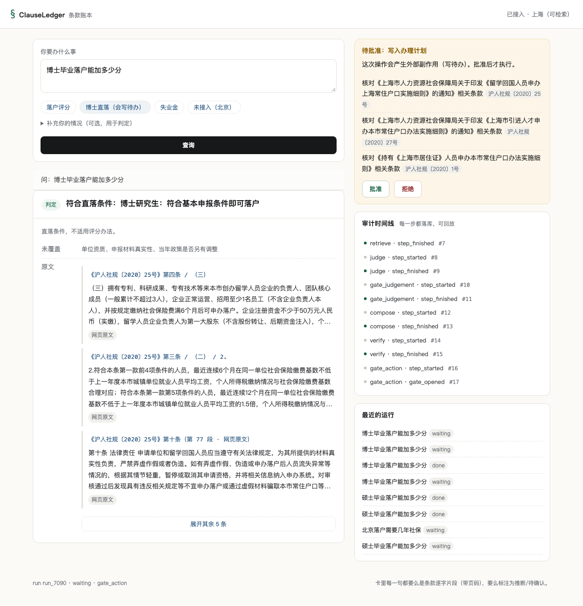

# 界面（S8-C）

一张单页，只做三件事：**提问 → 看卡 → 审批**。所有判断在服务端，界面不产生任何结论。



```bash
python -m uvicorn app.api.server:app --port 8010
# 打开 http://127.0.0.1:8010/
```





## 四个区域

| 区域 | 内容 | 数据来源 |
|---|---|---|
| 顶部横幅 | 覆盖状态（已接入 / 部分 / 未接入） | `CoverageIndex.check()` |
| 主卡 | 判定卡 / 标准卡 / 拒答卡 | `app/answer/cards.py::build()` |
| 审批面板 | 门控类型 + **将被写入的条目** + 批准/拒绝 | `state.gate.payload` |
| 审计时间线 | 每一步的 `step_started / step_finished / gate_opened` | `events` 表（SQLite） |

## 五个设计决定

1. **卡不是答案**。判定卡给"已知 24 / 上限 92 / 标准 72，至少还差 48"，
   不写成一段话——因为话可以编，分数不能。
2. **审批前先看到卡**。`gate_judgement` 停住之前就把草稿卡放进 `state.answer`，
   否则界面只有一个"待确认"按钮，等于让人盲批。写操作同理：面板列出三条待办原文。
3. **时间线来自事件表，不是日志**。每条带 `seq`，可回放；重启进程后仍在。
4. **覆盖率横幅常驻**。用户要先知道"这个城市接入没有"，再决定要不要信下面的卡。
5. **不引前端框架**。一个 HTML + 300 行 JS，`fetch` 四个端点；换框架不会让审计更可信，
   只会多一层构建。

## 明确没做

鉴权、流式输出、移动端适配、多语言、图表。演示用不到；要上生产先补前两项。

## 证据为什么默认折叠

一条条款引文动辄 200 字，八条就是一张长图。默认只展示三条、每条四行，点开看全文，
并标注来源（`第 21 页` / `网页原文` / `扫描件 OCR`）。证据的价值在于**能点回原文**，
不在于一次看全。
